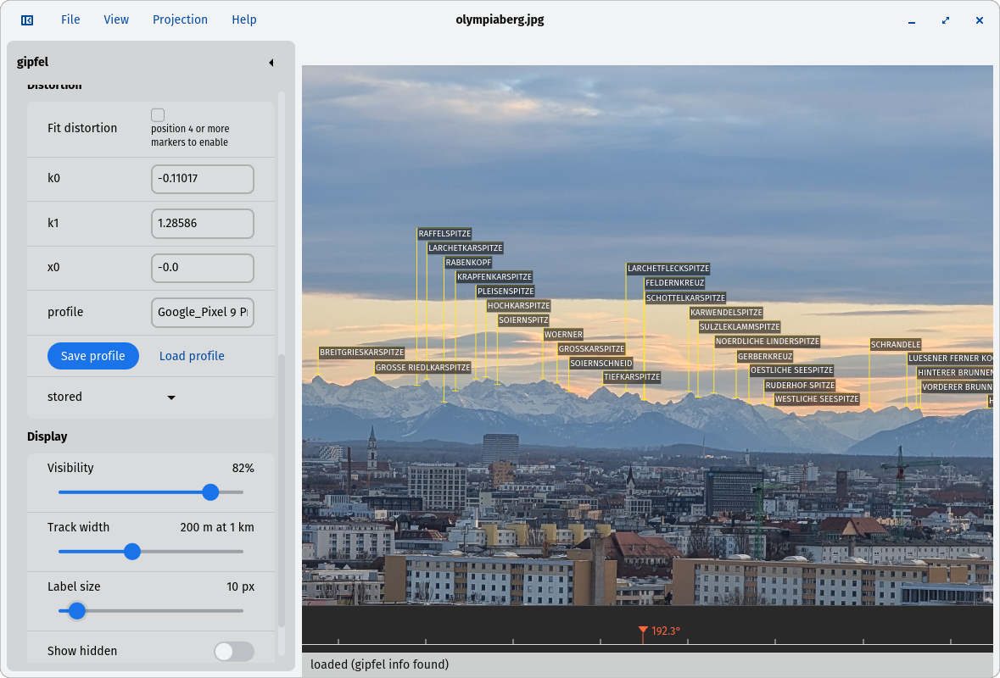

gipfel
======

[homepage](http://www.flpsed.org/gipfel.html)

Description
-----------
__gipfel__ helps to find the names of mountains or points of interest
on a picture.
It uses a database containing names and GPS data. With the given viewpoint
(the point from which the picture was taken) and two known mountains
on the picture, gipfel can compute all parameters needed to compute the
positions of other mountains on the picture.
gipfel can also be used to play around with the parameters manually.
But it's pretty difficult to find the right parameters for a given
picture manually.  
You can think of gipfel as a georeferencing software for arbitrary images
(not only satelite images or maps).  
gipfel also has an image stitching mode, which allows to generate
panorama images from multiple images that have been referenced with gipfel.
The nice thing about image stitching is that it reuses the code that
already exists for referencing images.  
gipfel uses the non-linear
[least squares method](http://en.wikipedia.org/wiki/Least_squares) to
compute the viewing parameters from the given data points.

Requirements
------------
* [cargo](https://github.com/rust-lang/cargo)
* gipfel works on UNIX-like systems (e.g. Linux, *BSD and probably others)

Installation
------------
Build the web site (see Build below), serve the resulting `dist/gipfel/`
directory with any static webserver and open it in a browser. Ready-made
desktop installers (.deb, AppImage, Windows installer) are built with the
commands in the Build section.

Build
-----
All targets share the platform-free library `crates/gipfel-core`; the
browser/WASM front end lives in `crates/gipfel`, the desktop installer
wrapper in `crates/gipfel-desktop`.

Prerequisites (all targets):

    rustup target add wasm32-unknown-unknown
    cargo install wasm-bindgen-cli

Web (static site, any webserver):

    ./crates/gipfel/build-release.sh      # assembles dist/gipfel/

dev loop: `./crates/gipfel/serve-here.sh` (refreshes /tmp/gipfel-dist).

Desktop installers (Tauri, `crates/gipfel-desktop`; needs node/npm once:
`npm i -D @tauri-apps/cli`):

    # Linux .deb + AppImage
    sudo apt-get install libwebkit2gtk-4.1-dev libgtk-3-dev librsvg2-dev libxdo-dev
    cd crates/gipfel-desktop && npx tauri build --bundles deb,appimage

    # Windows NSIS installer (cross-compiled from Linux)
    sudo apt-get install mingw-w64 nsis
    rustup target add x86_64-pc-windows-gnu
    npx tauri build --target x86_64-pc-windows-gnu --bundles nsis

Artifacts appear under `target/[x86_64-pc-windows-gnu/]release/bundle/`.
Installers are unsigned. The official targets are Web, Windows and Linux.

Running
-------
Open a picture (Open image… or drag & drop it onto the page). Depending
on whether gipfel could find localization data in the image metadata,
you need to set the viewpoint from which the picture was taken, either
in the Latitude/Longitude/Height fields or by pasting GPS coordinates
("47.676,13.32042").

Play around with the view parameters (Azimuth, Pitch, Roll, Focal)
until the projected dots roughly match the ridges in the picture.
Hover a dot to see which peak it represents; click a dot to mark it (or
click anywhere in the picture and pick the peak from the searchable
list). Drag a marker onto the position of the mountain in the picture;
right-click removes it. Once at least two mountains are positioned,
gipfel fits the view parameters automatically and moves the remaining
peaks to their correct positions. More markers improve the fit.

URL Parameters
--------------
The web app can be fully linked to: image and view parameters are
passed as URL query parameters, e.g.

    https://example.org/gipfel/?file=photo.jpg
    https://example.org/gipfel/?file=https://host/pano.jpg&az=57.4&pitch=-20

* `file` — image to open: a path on the same host, or an absolute
  `http(s)` URL (the remote host must allow CORS)
* `az` — azimuth in degrees (true north)
* `pitch` — pitch in degrees
* `roll` — roll in degrees
* `focal` — focal length in mm (35 mm equivalent)
* `vis` — visibility override (0.01–0.1, same scale as the Visibility
  slider; higher shows more distant peaks)

The parameters are applied *after* the image's own EXIF/gipfel
metadata, so they override values recorded in the photo. A `gipfel:`
comment saved by "Save image…" is read back when the saved file is
opened again, so annotated images carry their view without any URL
parameters.

You may also want to have a look at the (outdated)
[screen video](http://www.flpsed.org/images/gipfel.avi)
for an example session.

Data File
---------
As stated before, gipfel needs GPS input data. The input data must be
an ASCII file with one line per mountain / point of interest.
Each line must contain the following values separated by a comma:

	<SHORTNAME>,<NAME>,<DESCRIPTION>,<LATITUDE>,<LONGITUDE>,<HEIGHT>

<SHORTNAME> and <DESCRIPTION> may be left empty.

The following line is a valid example:
	SMTSBG,Simetsberg,,47.56617,11.25358,1836

Fortunately, there is a [great website](http://www.alpin-koordinaten.de),
where you can download a suitable file containg quite a lot of data mostly 
concerning the alps:
Click on the "Suchen" button and the click on the diskette symbol below
the first table then select "Fugawi 3 TXT" format and click on "Download".

You can easily add your own entries to the data file or add them
to the database at http://www.alpin-koordinaten.de.

Thanks to the kind permission of
[Jonathan de Ferranti](http://www.viewfinderpanoramas.org/) and the
creators of http://www.alpin-koordinaten.de, the standard gipfel
tarball includes a default datafile generated from these two sources.

For the USA, you can download a data file
from [USGS](http://geonames.usgs.gov/domestic/download_data.htm)
The file can be transformed for gipfel with
	awk 'BEGIN {FS="|"; OFS=","};
	     $3 == "Summit" {print "usgs_" $1, $2,"" , $10, $11, $16};'

GPS Tracks
----------
Once you have determined the right parameters using the procedure described
above, you can load GPS tracks and display them on the picture. Use the
"Load GPX Track…" button. GPS tracks should be in GPX format.
GPS tracks are displayed with variable width depending on the distance 
of the way points from the current view point and the scale value. 
You can also modify the width using the "Track Width" slider.

Loading and Saving Images
-------------------------
gipfel allows to save the image parameters in the comment section of 
the JPEG image. Use the "Save image…" button. 
Note, that in the saved image all previous JPEG comments are removed.
If you open an image containing gipfel image parameters, they are 
automatcally set.

Hidden Object Detection
-----------------------
gipfel tries to identify objects in its database, that are hidden by others.
This is done by assuming that every object/peak has the form of a cone 
with a fixed steepness. If such imaginary cone would hide the view to a
point in the database, gipfel marks it as hidden. Hidden objects are
not shown by default, but you can enable their display using the
"Show hidden peaks" checkbox. Hidden objects and hidden GPS way points
are displayed in blue.

Refraction
----------
Refraction caused by temperature and density gardients in the atmosphere is
taken into account according to the approximation described by
[Tom Chester](http://tchester.org/sgm/analysis/peaks/refraction_calculation.html).
under the assumption of a temperature change of 6.5C per 1000m and a
temperature T0 at view point level of 10C.

Exif Data
---------
gipfel tries to get useful information from the exif data of the
input image. It uses the "Focal Length in 35mm Film" and the 
"GPS Longitude", "GPS Latitude", and "GPS Height" parameters, if they
exist.

Lens Distortion
---------------
Typical lenses especially wide-angle lenses diverge from the optimal
rectilinear projection.
gipfel can partly correct the resulting errors.
To this end gipfel uses a standard distortion model with three parameters 
(k0, k1, and x0). Depending on these values, the distance d of an image
point from the center is modified by (k0 * d + k1 * d ^ 2).
x0 is the main point offset in X direction.  

If you mark and position more than 3 mountains on an image and enable distortion fitting,
gipfel tries to correct lens distortion.
Once you have reasonable values for k0 and k1 for a special camera and
focal length you can save the distortion profile (Distortion profiles → Save).
Whenever you now open an image taken with this camera model and focal
length, gipfel will use this distortion profile.
Independent of the distortion profiles one can also modify the
distortion parameters per image.
Distortion correction is also used when stitching panorama images.

Stitching Panorama Images
-------------------------
If you have multiple images from the same viewpoint referenced with gipfel
you can stitch them together to form a panorama image.
For stitching the input images must all have been correctly referenced
with gipfel and saved (see "Loading and Saving Images").
You can then call `gipfel stitch -t <outimg> <img1> <img2> ...`
to save the result as TIFF image.
To get multiple TIFF images as input for
<http://enblend.sourceforge.net/>, call gipfel like this:
`for i in *.jpg; do gipfel -s -b -t tiff/$i $i; done`

The width and height of the result images can be adjusted with
additional -w and -h options.
You can use the -b switch to enable bicubic interpolation, which
gives smoother results but is a bit slower.  

gipfel simply scans all directions needed for the panorama and determines
where these directions would end up on the various pictures. It can then
record the corresponding color values from the input images.  

In contrast to other stitching programs, the input images don't need to
overlap.

If you want to open a stitched image in gipfel to locate the mountains
on it, don't forget to choose Panoramic Projection!

Troubleshooting
---------------
* Obviously gipfel can only be as good as its input data. If there is no 
  data about the mountains on your picture, you are out of luck...
  But as the data file format is pretty simple and GPS receivers are common, 
  you can build up your own datafile.
* gipfel only works with full normal unmodified pictures taken with a 
  non-distorting standard objektive. If you have a panorama picture, you
  might want to try the "Panoramic Projection" support which 
  imlements a cylindrical projection (see "Projection" menu).
* I don't know, whether gipfel currently works correctly on pictures taken on
  the southern hemisphere, but I would appreciate any feedback about it.

Acknowledgements
----------------
Thanks to the guys from http://www.alpin-koordinaten.de for their public
GPS database. 
Also have look at their other [site](http://www.alpen-panoramen.de).
In newer versions I use [maxima](http://maxima.sourceforge.net/) for
symbolic computation and code generation.
I also want to thank my brother Martin for his suggestions and the
discussions.

DISCLAIMER
----------
gipfel must __not__ be used for real navigation. You should not rely on the 
results of gipfel.

Johannes Hofmann, <Johannes.Hofmann@gmx.de>
